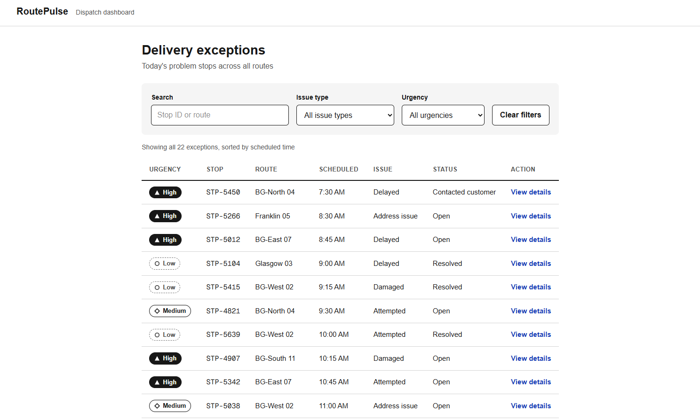
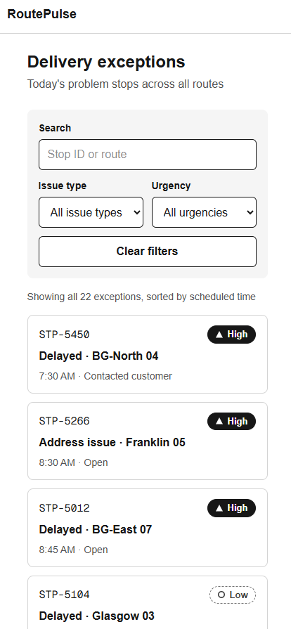
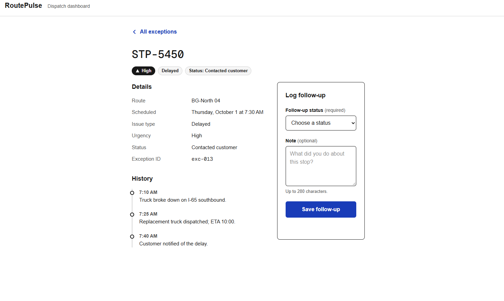
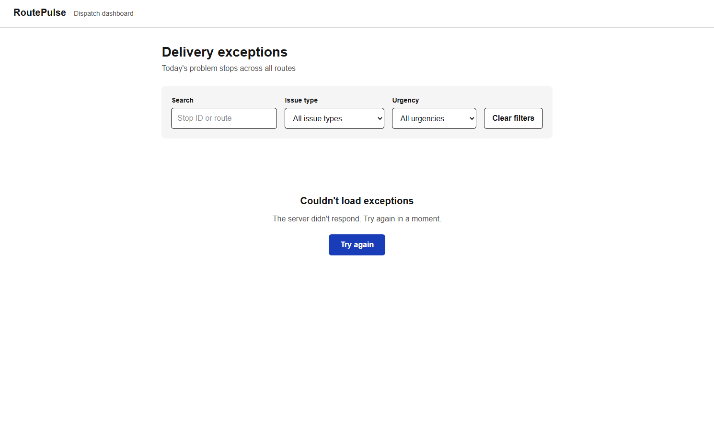

# RoutePulse

A dispatcher dashboard for reviewing and following up on delivery exceptions: late stops, failed attempts, damaged packages, and bad addresses.

**Live site:** https://routepulse-lovat.vercel.app/




---

## The problem

On a normal delivery day, most stops go fine. The ones that don't are **exceptions**: a package that's running late, a delivery attempted with nobody home, a box that arrived damaged, an address that doesn't exist. Each one needs someone to decide what happens next: call the customer, reschedule, or mark it resolved.

I spent eight years as a delivery driver, so I've been the person creating those exceptions at the curb. What I saw on the ground was that problem stops get buried. They're mixed in with hundreds of good stops, spread across routes, and urgent ones look the same as routine ones.

RoutePulse gives a dispatcher **one focused view of only the problem stops**. They can narrow the list by issue type and urgency, open a stop to see its history, and log a follow-up without leaving the page.

## My contribution

I designed and built the whole project as a one-week portfolio sprint, working from a scope set by my career advisor:

- Wireframes, data model, and 22-record mock dataset based on real exception types
- All UI components, the filtering logic, and the follow-up workflow
- Loading, error, empty, and no-matches states for the list
- Test suite, GitHub Actions CI, and Vercel deployment
- Lighthouse audit, with two measured performance fixes

Every change went through a feature branch and pull request, with CI required to pass before merge.

## Stack

| | |
|---|---|
| **Framework** | Next.js 16.3.8 (App Router) |
| **Language** | TypeScript |
| **Styling** | Tailwind CSS |
| **Testing** | Vitest, React Testing Library, jest-dom |
| **CI** | GitHub Actions (lint, test, production build) |
| **Hosting** | Vercel |

There is no real backend. A Next.js API route serves mock data so the UI can show real async loading and error behavior.

## Screenshots

| Desktop | Mobile |
|---|---|
|  |  |

| Exception detail and follow-up form | Error state |
|---|---|
|  |  |

## How it works

### Data model

Each exception is a typed record (`lib/types.ts`):

```ts
interface DeliveryException {
  id: string;
  stopId: string;
  route: string;
  scheduledTime: string;      // ISO 8601
  category: IssueCategory;    // "delayed" | "attempted" | "damaged" | "address-issue"
  urgency: Urgency;           // "low" | "medium" | "high"
  status: FollowUpStatus;     // "open" | "contacted-customer" | "rescheduled" | "resolved"
  history: HistoryEvent[];
}
```

Categories, urgencies, and statuses are string-literal unions instead of plain strings, so a typo like `"damage"` is a compile error. Each union has a matching label map (for example, `"address-issue"` → `"Address issue"`) so display text lives in one place.

### Component structure

```
app/
  page.tsx                    → <ExceptionDashboard />
  exceptions/[id]/page.tsx    → server-rendered detail page
  api/exceptions/route.ts     → mock API
components/
  ExceptionDashboard.tsx      → owns fetch state and filters
  FilterBar.tsx               → search, category, urgency
  ExceptionTable.tsx          → desktop layout
  ExceptionCards.tsx          → mobile layout
  ListStates.tsx              → loading / error / empty / no-matches
  UrgencyBadge.tsx
  FollowUpForm.tsx
lib/
  filters.ts                  → pure filtering logic
  follow-ups.ts               → pure follow-up logic
  follow-up-context.tsx       → session state for follow-ups
```

The rule I followed was to **keep logic out of components where possible.** Filtering and applying follow-ups are plain functions in `lib/`, with no React involved. That makes them easy to test directly and easy to reason about.

### UI state strategy

The list can be in one of four states, and the filter bar stays on screen in all of them so the layout doesn't jump:

| State | When | What the user sees |
|---|---|---|
| Loading | Fetch in progress | Skeleton rows |
| Error | Fetch failed or returned non-200 | Message and a **Retry** button |
| Empty | Fetch succeeded with zero exceptions | "No exceptions today" |
| No matches | Exceptions exist but filters hide all of them | Message and a **Clear filters** button |

Separating "empty" from "no matches" matters to a dispatcher. One means the day is clean. The other means *your filters* are hiding something.

## Technical decisions

1. **Client fetch from a mock API route.** The list fetches `/api/exceptions` on the client instead of importing the data directly. That gives the UI real loading and error states to handle, which is the point of the exercise, without building a backend.

2. **Fetch state as a discriminated union.**
   ```ts
   type FetchState =
     | { status: "loading" }
     | { status: "error"; message: string }
     | { status: "success"; data: DeliveryException[] };
   ```
   TypeScript won't let the component read `data` until it has checked `status === "success"`. It's impossible to render a list that hasn't loaded.

3. **Follow-ups in React Context, scoped to the session.** Saved follow-ups live in a provider in the root layout, so they persist when moving between the list and a detail page. A refresh clears them. That's intentional: there's no backend to save to, and pretending otherwise with `localStorage` would hide that.

4. **The form takes an `onSave` prop instead of reading Context itself.** This keeps `FollowUpForm` testable in isolation, with no provider to set up in tests.

5. **The detail page reads data on the server.** `app/exceptions/[id]/page.tsx` is a server component that imports the mock data directly instead of calling its own API over HTTP. Unknown IDs call `notFound()` and get a dedicated 404 page.

6. **Times are pinned to `America/Chicago`.** My machine and the CI runner (UTC) were formatting times differently, which made tests pass locally and fail in CI. Pinning the time zone in `lib/format.ts` makes output identical everywhere.

7. **Demo states are opt-in.** The API accepts `?simulate=slow` (1.5 s delay) and `?simulate=error` (HTTP 500), so loading and error states can be demonstrated without slowing down normal use. See [Demo states](#demo-states).

8. **Prefetching is off for list links.** Next.js prefetches every visible `<Link>` by default. With 22 rows, that meant 9 background requests for detail pages nobody had opened yet, during the window where the page is becoming interactive. See [Performance](#performance).

## Accessibility

- **Urgency isn't color-only.** Each badge combines a shape (triangle, diamond, circle), a fill style (solid, outline, dashed), and a text label.
- **The table is semantic.** It has `<th scope="col">` headers, `<time dateTime>` for scheduled times, and screen-reader-only text on links so "View" announces *which* stop.
- **The filter bar is a landmark.** It uses `role="search"` with labeled controls. Inputs use a 16 px font so iOS Safari doesn't zoom in on focus.
- **The follow-up form handles errors accessibly:**
  - On a failed submit, focus moves to the first invalid field.
  - Invalid fields get `aria-invalid="true"` and are linked to their error text with `aria-describedby`.
  - Errors are announced with `role="alert"`, success with `role="status"`.
  - Errors show an icon and text, not just a red border.
- **The whole flow works by keyboard:** filter the list, open a stop, submit a follow-up, and return.

Lighthouse Accessibility score: **100**.

## Testing

Seven tests across three files, run with Vitest and React Testing Library. They focus on behavior a user would notice, not implementation details.

| File | What it covers |
|---|---|
| `ExceptionDashboard.test.tsx` | Loading → list on success · error alert on a 500, then recovery via Retry · filtering by urgency and category, and the no-matches state |
| `FollowUpForm.test.tsx` | Empty submit is blocked, error is announced, focus moves, and `aria-invalid` / `aria-describedby` are set · valid submit calls `onSave` with trimmed input and announces success |
| `logic.test.ts` | Case-insensitive search that ignores surrounding whitespace · applying follow-ups without mutating the source data |

`fetch` is mocked with `vi.spyOn(globalThis, "fetch")` so tests control the API response, including failures.

### CI

Every pull request and every push to `main` runs, in order:

```
npm ci → npm run lint → npm run test:run → npm run build
```

Node version comes from `.nvmrc`, so CI and local development match.

## Performance

Audited with Lighthouse (Mobile, Navigation mode) against the production deployment. Two changes:

1. **Removed a hard-coded 600 ms delay** from the mock API that I'd added during development. Slow loading is now opt-in through `?simulate=slow`.
2. **Disabled prefetch on the list's detail links**, removing 9 speculative requests during page load.

| Metric | Before | After |
|---|---|---|
| Performance | 91 | **95** |
| Total Blocking Time | 370 ms | **200 ms** |
| Requests during load | 22 | **13** |
| API response | 855 ms | **60 ms** |
| Accessibility / Best Practices / SEO | 100 / 100 / 100 | 100 / 100 / 100 |

These are single runs, and both changes were measured together. Full reports, methodology, and caveats are in [`docs/lighthouse/`](docs/lighthouse/).

## Demo states

The mock API supports two query parameters for demonstrating states that normally don't appear:

| URL | Result |
|---|---|
| [`/api/exceptions?simulate=slow`](https://routepulse-lovat.vercel.app/api/exceptions?simulate=slow) | Responds after 1.5 s |
| [`/api/exceptions?simulate=error`](https://routepulse-lovat.vercel.app/api/exceptions?simulate=error) | Responds with HTTP 500 |

To see the **UI** states in the browser, use Chrome DevTools:

- **Loading:** Network tab → set throttling to **3G** → reload.
- **Error and recovery:** Network tab → right-click the `/api/exceptions` request → **Block request URL** → reload. Then remove the block and click **Retry**.

## Running locally

Requires Node.js (version in `.nvmrc`).

```bash
git clone https://github.com/brenthippler-art/routepulse.git
cd routepulse
npm ci
npm run dev
```

Open http://localhost:3000.

| Command | Does |
|---|---|
| `npm run dev` | Start the dev server |
| `npm test` | Run tests in watch mode |
| `npm run test:run` | Run tests once (used in CI) |
| `npm run lint` | Run ESLint |
| `npm run build` | Production build |

## Scope

Following the project brief, RoutePulse deliberately does **not** include authentication, maps, route optimization, or a real database. The goal was a small, complete, well-tested frontend rather than a broad, unfinished one.

If I kept going, the next steps would be:

- Persist follow-ups to a real backend.
- Render one responsive list instead of both a table and cards, which would roughly halve the DOM size.
- Add an end-to-end test of the full list → detail → follow-up flow with Playwright.

---

Built by [Brenton Hippler](https://brentoncodes.dev) · [LinkedIn](https://www.linkedin.com/in/brenton-hippler-818b6397)